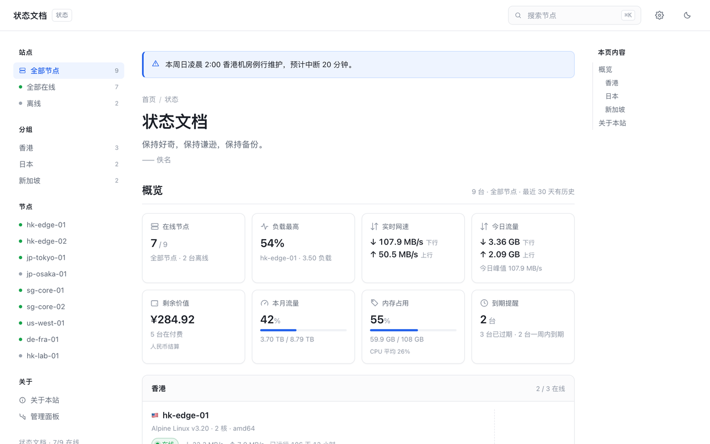

# monitor-theme-doc

[monitor](https://github.com/monitor-probe/monitor) 的文档风格状态页主题：三栏排版、左侧目录、右侧本页导航，
整组节点装进一张大卡片。只读公开接口，不写任何数据。



- 八张概览卡：在线节点、最忙的机器、实时网速、今日流量、剩余价值、本月流量、内存占用、到期提醒
- 两种节点布局：单个大卡片 / 小卡片网格
- 节点详情：资源曲线、网络延迟，延迟曲线可以平滑、削峰
- 左侧「全部节点 / 全部在线 / 离线 / 分组」即筛选，概览与导语跟着算
- 深浅色、四种强调色；站长登录后可在页头的设置抽屉里改站点选项

## 安装

在 hub 后台的「主题」页填本仓库地址，点「从 GitHub 安装」：

```text
https://github.com/bluesmkun/docxq
```

hub 会取最新正式 release 里的 `theme.tar.gz`。也可以下载这个文件在面板上传，或者把它解开、
把目录改名成 `doc/` 放进 hub 的 `--themes` 目录。

## 路由

| 路径 | 页面 |
|---|---|
| `/` | 节点总览 |
| `/node/{id}` | 节点详情 |

未知路径回落到 `dist/index.html`。hub 前面若有按路径做白名单的反代或 WAF，要放行 `/node/`，
否则「点进去正常、一刷新就被拦」。

## 主题设置

站点级选项写在 `theme.json` 的 `config` 里，hub 后台和本主题的设置抽屉共用同一份声明：

| 分组 | key | 默认 | 说明 |
|---|---|---|---|
| 首页 | `notice` | 空 | 顶部提示框，纯文本 |
| 首页 | `quote` | 空 | 每日一言，每行一句，可写「正文 —— 作者」；留空用自带的句子 |
| 首页 | `show_summary` | 开 | 节点列表上方的八张概览卡 |
| 首页 | `sidebar` | 开 | 左侧目录 |
| 首页 | `footer` | 空 | 页脚文字 |
| 节点卡片 | `layout` | `panel` | `panel` 单个大卡片 / `cards` 小卡片网格 |
| 节点卡片 | `show_usage` | 开 | 资源进度条 |
| 节点卡片 | `show_price` | 开 | 价格与到期；没填价格显示「免费」，没有到期日显示「无限」 |
| 节点卡片 | `show_remark` | 开 | 公开备注 |
| 节点卡片 | `columns` | 3 | 小卡片网格的列数上限 1–5 |
| 外观 | `accent` | `blue` | `blue` / `green` / `orange` / `violet` |
| 外观 | `dark` | `auto` | `auto` / `light` / `dark` |
| 剩余价值 | `currency` | `CNY` | 概览里的剩余价值用哪种货币显示 |
| 剩余价值 | `fx_rates` | 空 | 手动汇率，如 `USD=7.2, HKD=0.92` |
| 关于本站 | `about_title` | `关于本站` | 左侧目录和页面上那块的小标题 |
| 关于本站 | `about` | 空 | 正文，支持 Markdown；留空显示主题自带说明 |

## 开发

```bash
pnpm install
MONITOR_HUB=https://hub.example.com pnpm dev
```

不设 `MONITOR_HUB` 时代理至 `http://127.0.0.1:9911`。仓库带了一个假 hub，可以离线看效果：

```bash
pnpm build && node scripts/mock.mjs
```

发版打 tag 即可，`.github/workflows/release.yml` 会构建、打包并把 `theme.tar.gz` 挂到 release 上：

```bash
git tag v1.0.0 && git push origin v1.0.0
```

## 许可

MIT
